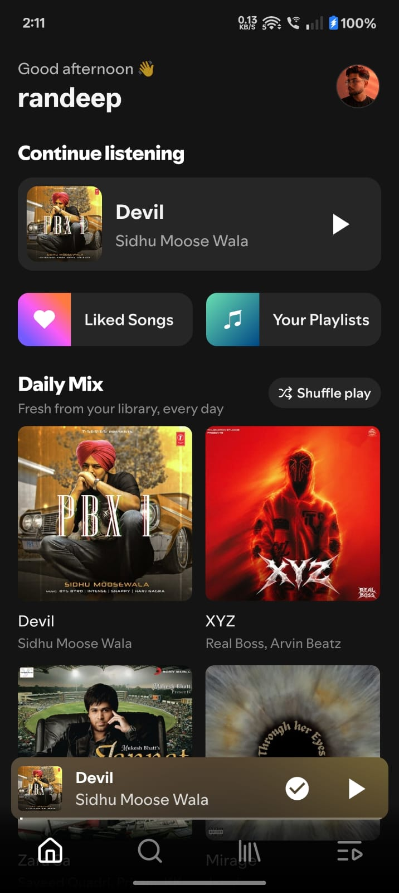
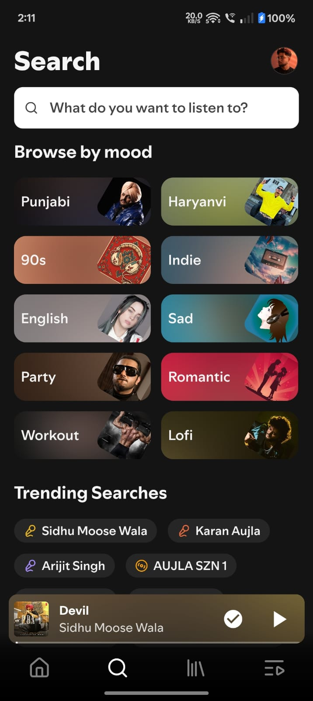
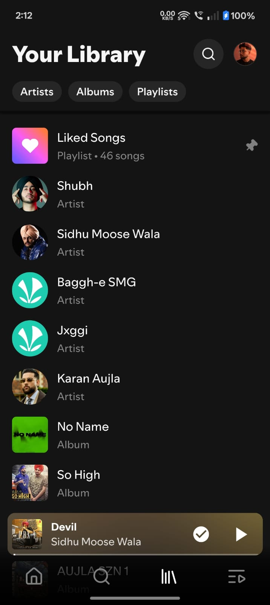
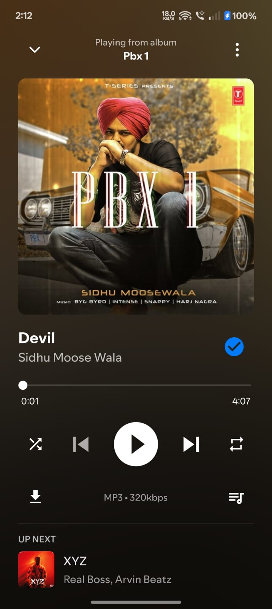

# 🌌 Nebula — Music, Your Way.

A personal music streaming app built with React Native and Expo.

Nebula started as a simple idea: creating a music app where I could stream and download music without dealing with subscription fees. What began as a small web demo eventually evolved into a dedicated mobile application.

This project has been rebuilt multiple times, with each iteration bringing improvements, new learnings, and a better user experience.

## ✨ Features

- 🎵 **Music Streaming** — Discover and stream your favourite tracks.
- 📥 **Offline Downloads** — Download songs for offline listening.
- 🔍 **Music Search** — Find songs and explore music.
- ❤️ **Liked Songs** — Keep your favourite tracks in one place.
- 📚 **Personal Library** — Access your music, playlists and collections.
- 🎧 **Background Playback** — Continue listening while using other apps.
- 📋 **Queue Management** — Manage your upcoming tracks.
- 🌙 **Dark UI** — A dark interface inspired by modern music streaming applications.

## 📱 Screenshots

| Home | Search | Library | Player |
|---|---|---|---|
|  |  |  |  |


## 🛠️ Tech Stack

- **React Native** — Cross-platform mobile development.
- **Expo** — Development and native build tooling.
- **TypeScript** — Type-safe development.
- **Zustand** — State management.
- **TanStack Query** — Server state and data fetching.
- **Expo Router** — File-based navigation.
- **React Native Track Player** — Audio playback.

## 🚀 Getting Started

### Prerequisites

- Node.js
- npm
- Expo development environment
- Android Studio (for Android development)

### Installation

Clone the repository:

```bash
git clone YOUR_REPOSITORY_URL
```

Navigate to the project directory:

```bash
cd nebula
```

Install dependencies:

```bash
npm install
```

Start the development server:

```bash
npx expo start
```

Follow the Expo CLI instructions to run the application on your device or emulator.

## 📦 Download APK

https://github.com/randeep88/Nebula-v3/releases/download/v3/Nebula-v3.apk

## 🎯 Why Nebula?

I initially started this project for myself because I wanted a music experience that didn't require a paid subscription.

Building Nebula pushed me to explore React Native more deeply, work with native libraries, solve UI challenges, and understand mobile application development beyond the basics.

This is my third major attempt at building Nebula, and every iteration has taught me something new.

## 🗺️ What's Next?

- Improve the overall user experience.
- Fix bugs and improve stability.
- Optimize playback and performance.
- Prepare for a public release.

## ⚠️ Disclaimer

Nebula is an independent personal project. It is not affiliated with, endorsed by, or associated with Spotify.

Music availability and downloading capabilities depend on the underlying content sources and their applicable permissions. This project does not claim ownership of third-party music.

## 👨‍💻 Author

**Randeep**

Web Developer | React Native Developer

Building things, learning along the way.

---

⭐ If you find this project interesting, consider giving the repository a star!
